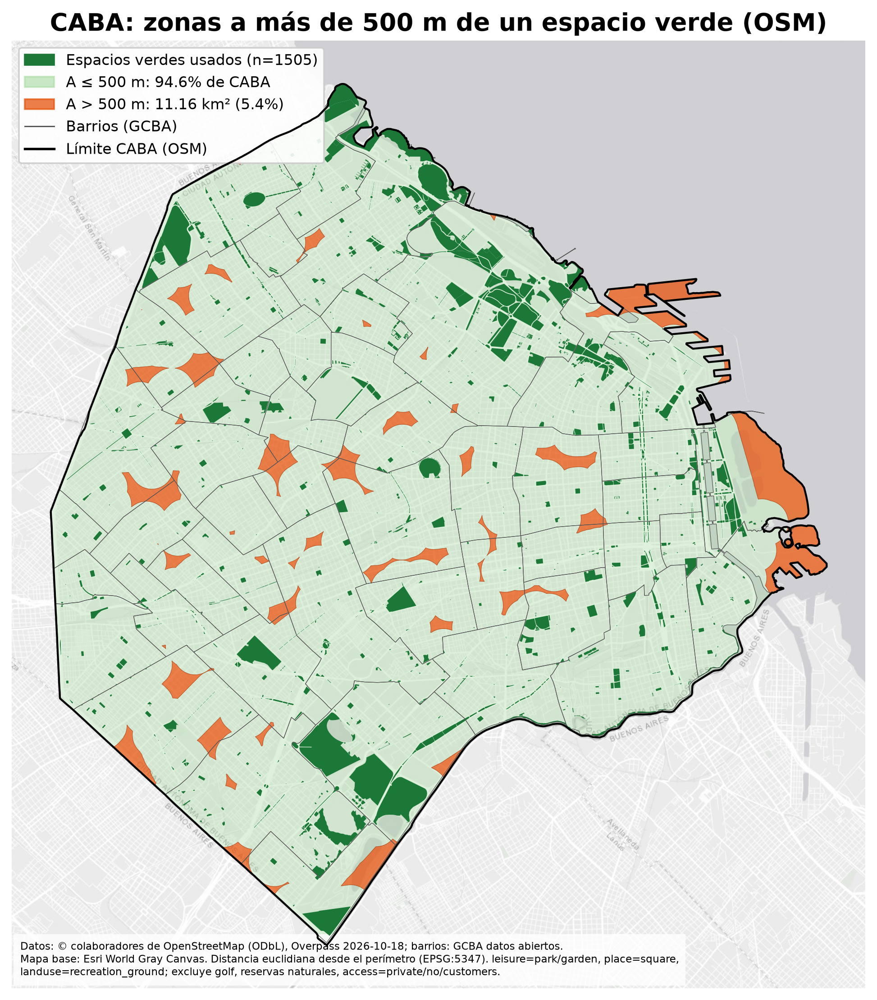
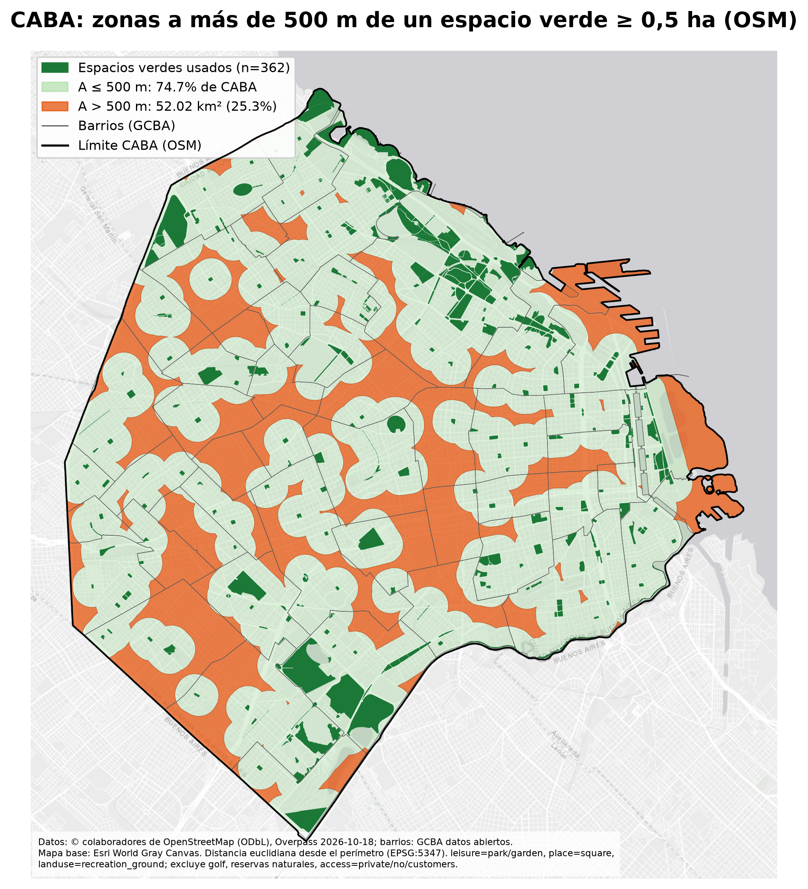
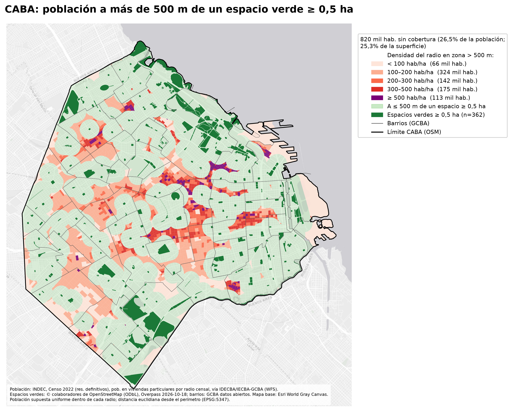
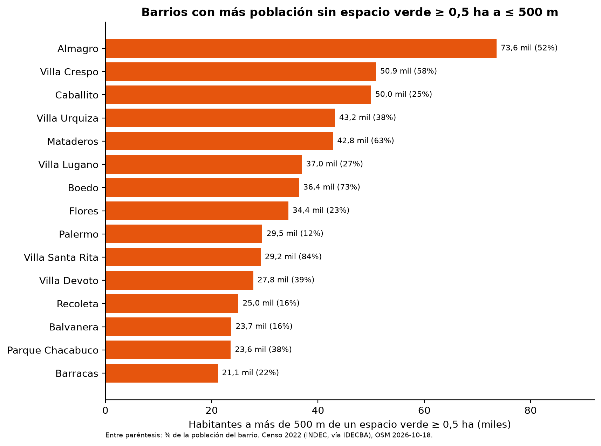
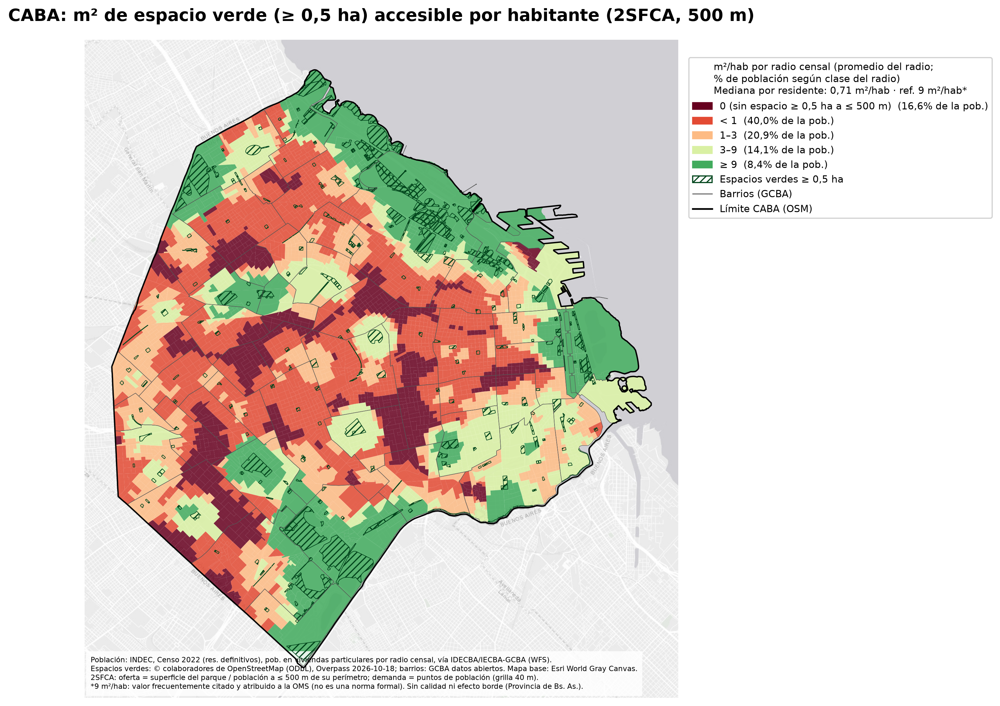
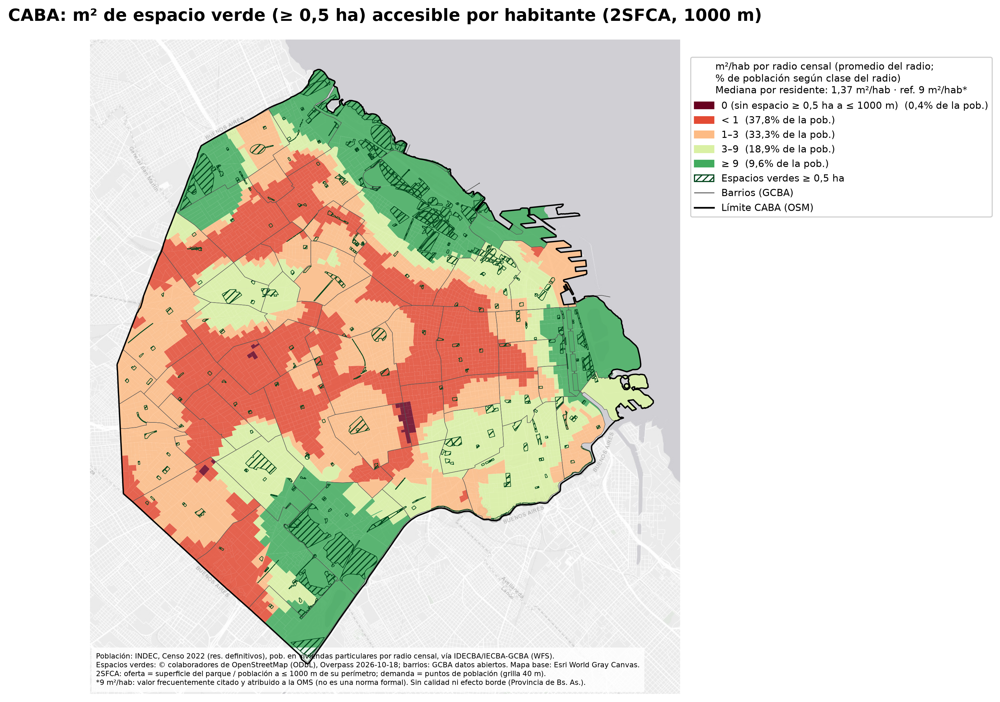
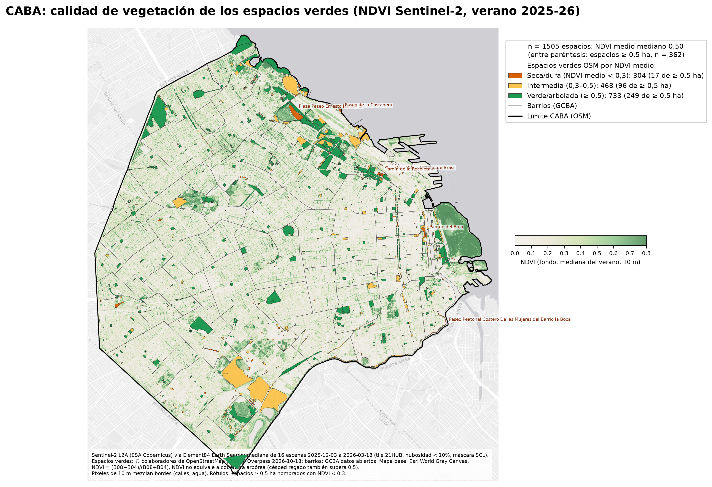
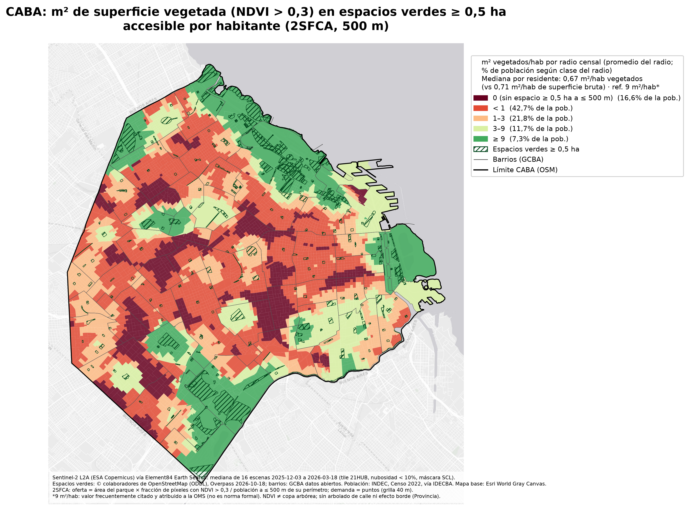
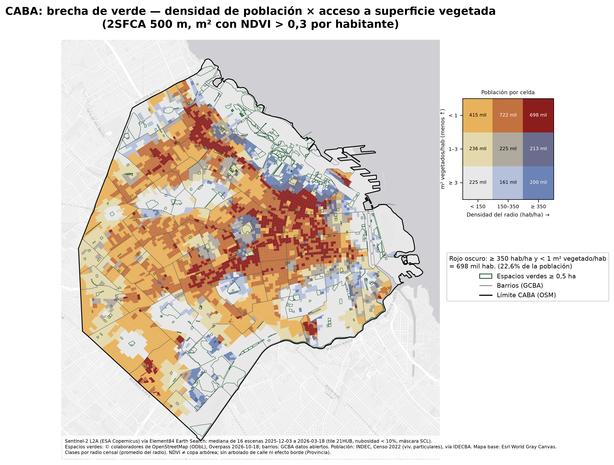

# 🌳 CABA Espacios Verdes

How much of Buenos Aires is within a short walk of a public park, who lives beyond that walk, and how much of the park is actually vegetated. The pipeline downloads parks and plazas from OpenStreetMap, buffers each one by 500 m from its perimeter, weights the gap by the 2022 census, and estimates accessible green square metres per resident with a two-step floating catchment area (2SFCA). A summer Sentinel-2 NDVI composite then repeats the access metric on vegetated area.

The figures in this README are from the run dated 18 October 2026 (Overpass extract of that day, INDEC census 2022, Sentinel-2 summer 2025–26). A fresh clone regenerates the tables; it does not ship them.

[](https://github.com/estcarisimo/caba-espacios-verdes/actions/workflows/ci.yml)
[](https://www.python.org/downloads/)
[](https://opensource.org/licenses/MIT)
[](https://github.com/astral-sh/ruff)

## Resumen en castellano

Análisis del acceso a espacios verdes públicos en la Ciudad Autónoma de Buenos Aires. Se descargan parques, plazas, jardines y polideportivos de OpenStreetMap, se traza un buffer de 500 m desde el perímetro (distancia euclidiana, EPSG:5347) y se mide la superficie y la población que quedan afuera. La población es la del Censo 2022 (INDEC), viviendas particulares por radio censal, vía el WFS de IDECBA. El 2SFCA estima m² de verde accesible por habitante. Un compuesto mediano de NDVI de Sentinel-2 L2A (verano 2025-26) más WorldCover y el modelo de altura de copa de Meta/WRI distinguen superficie vegetada de polígono bruto.

Con todos los espacios, el 5,42% de la superficie y el 3,88% de la población quedan a más de 500 m. Si se cuentan sólo los espacios de al menos 0,5 ha, esas cifras pasan a 25,28% de la superficie y 26,50% de la población (820.223 personas). La mediana del 2SFCA a 500 m es 0,71 m²/hab; ponderando por NDVI > 0,3 baja a 0,67. Los informes en español están en [`docs/informe_poblacion.md`](docs/informe_poblacion.md) y [`docs/informe_calidad.md`](docs/informe_calidad.md).

## ✨ Features

- 🗺️ **500 m coverage from the perimeter**: straight-line buffer in EPSG:5347, for every public space and for spaces of at least 0.5 ha
- 👥 **Census weights**: INDEC 2022 population in private dwellings, 3,820 radios, joined to GCBA barrios by area
- 📐 **2SFCA supply**: dissolved park units, 40 m population grid, catchment at 500 m and at 1,000 m
- 🌿 **Vegetation quality**: Sentinel-2 L2A median NDVI (summer 2025–26), ESA WorldCover 2021 tree class, Meta/WRI canopy height
- 📉 **Density-versus-access map**: radios classed by population density and vegetated m² per resident
- 🔁 **One command per stage**: `download`, `coverage`, `population`, `quality`, `maps`, or `all`
- 📦 **Nothing bulky in git**: OSM, census, Sentinel and canopy tiles land in `data/`; CSV and JSON summaries land in `results/`

## 🚀 Quick Start

### Installation

This package is not on PyPI. Clone it and install with [uv](https://docs.astral.sh/uv/):

```bash
curl -LsSf https://astral.sh/uv/install.sh | sh

git clone https://github.com/estcarisimo/caba-espacios-verdes.git
cd caba-espacios-verdes
uv sync
```

`uv sync` creates `.venv` and installs the package. Prefix later commands with `uv run`, or activate the environment:

```bash
source .venv/bin/activate
caba-espacios-verdes --help
```

### System requirements

- Python 3.10 or newer
- Network access for OpenStreetMap, the GCBA open-data files, the IDECBA WFS, Element84 Earth Search, ESA WorldCover and (for the quality stage) the Meta/WRI canopy tiles
- Disk space for the quality stage: two canopy-height tiles of about 530 MB each, plus the Sentinel-2 window written under `data/calidad_src/`
- The PNG figures already in `figures/` can be read with no download

`make all` runs the whole pipeline. The Sentinel composite and the canopy tiles dominate the runtime; coverage and population are the lighter stages.

## 📖 Usage

Stages run in this order. Each one reads what the previous stage wrote.

```bash
# 1. OSM (pinned to 2026-10-18), GCBA barrios, census radios
uv run caba-espacios-verdes download

# 2. Polygons, filters, 500 m buffers, per-barrio area tables
uv run caba-espacios-verdes coverage

# 3. Population beyond 500 m, 2SFCA, m² inside each barrio
uv run caba-espacios-verdes population

# 4. Sentinel-2 median, NDVI classes, vegetated 2SFCA, bivariate classes
uv run caba-espacios-verdes quality

# 5. PNG maps (and one Folium HTML map) into figures/
uv run caba-espacios-verdes maps

# Or all five:
uv run caba-espacios-verdes all
```

The same targets exist in the `Makefile` (`make download`, `make coverage`, `make population`, `make quality`, `make maps`, `make all`).

Draw one map set when the earlier stages are already done:

```bash
uv run caba-espacios-verdes maps --only coverage
uv run caba-espacios-verdes maps --only population
uv run caba-espacios-verdes maps --only quality
```

Useful switches:

```bash
# Live OpenStreetMap instead of the 2026-10-18 attic extract
uv run caba-espacios-verdes download --osm-date now

# Re-download inputs that are already on disk
uv run caba-espacios-verdes download --force

# Skip the ~1 GB canopy download. NDVI and WorldCover still run;
# the canopy columns are omitted, so the published correlations are not reproduced.
uv run caba-espacios-verdes quality --skip-canopy

# Rebuild the Sentinel median even if the GeoTIFF already exists
uv run caba-espacios-verdes quality --rebuild-composite

uv run caba-espacios-verdes version
```

`download` writes `data/raw/`. `coverage` writes polygon GeoJSON under `data/interim/` and `results/resumen.json`. `population` and `quality` add the other JSON and CSV files under `results/`. `maps` writes PNG files under `figures/` and `figures/mapa_cobertura_500m.html` (gitignored). Existing downloads are kept unless you pass `--force` or `--rebuild-composite`.

## 🔧 Configuration

Paths default to directories next to the repository root. Override them with flags or with environment variables (the flag wins when you pass it):

| Variable | Flag | Default | Contents |
| --- | --- | --- | --- |
| `CABA_DATA_DIR` | `--data-dir` | `data` | Overpass JSON, barrios, census GeoJSON, interim geometries, Sentinel composite, canopy tiles |
| `CABA_RESULTS_DIR` | `--results-dir` | `results` | `resumen*.json`, per-barrio CSV, per-park quality CSV |
| `CABA_FIGURES_DIR` | `--figures-dir` | `figures` | PNG maps and the Folium HTML map |

```bash
export CABA_DATA_DIR=/var/cache/caba-espacios-verdes
uv run caba-espacios-verdes all --results-dir ./results --figures-dir ./figures
```

`download --osm-date` accepts `YYYY-MM-DD` or `now`. The default is `2026-10-18`, the date of the extract behind the figures and the numbers below. There is no YAML config file: distances, thresholds and the census constants live in `src/caba_espacios_verdes/sources.py` and in the stage modules.

| Constant | Value | Role |
| --- | --- | --- |
| Metric CRS | EPSG:5347 (POSGAR 2007 / Argentina 5) | Buffer and area |
| Buffer | 500 m from the perimeter, 16 quadrant segments; also reported at 1,000 m for 2SFCA | Coverage and catchment |
| Minimum park | 0.5 ha | Second scenario and 2SFCA supply |
| Population grid | 40 m, on the radio minus OSM green polygons | 2SFCA demand |
| NDVI classes | mean &lt; 0.3 dry/hard, 0.3–0.5 intermediate, ≥ 0.5 green/treed | Quality map |
| Vegetated fraction | share of pixels with NDVI &gt; 0.3, weighted by the fraction of the pixel inside the polygon | Vegetated m² |
| Sentinel window | 2025-12-01 to 2026-03-31, tile cloud cover &lt; 10%, SCL classes 4, 5 and 6 | Median composite |

The GCBA barrio file stores uppercase `BARRIO` / `COMUNA` (`BOCA`). On download, and again whenever a stage loads the file, names are written as `nombre` / integer `comuna` with the labels used in the tables (`La Boca`, `Villa Gral. Mitre`). The geometry is unchanged.

## 🏗️ Architecture

```text
src/caba_espacios_verdes/
├── cli.py                 # caba-espacios-verdes: download, coverage, population, quality, maps, all
├── download.py            # Overpass, GCBA barrios, IDECBA WFS, Meta/WRI tiles
├── osm.py                 # Overpass ways/relations -> polygons and the raw inventory
├── coverage.py            # Filters and the three 500 m scenarios
├── population.py          # Census overlay, dasymetric check, 2SFCA, m² per barrio
├── quality_composite.py   # Sentinel-2 L2A median B04/B08/NDVI on the native 10 m grid
├── quality.py             # Zonal NDVI, WorldCover, canopy height, vegetated 2SFCA, brecha
├── maps_coverage.py       # Coverage PNGs and the Folium map
├── maps_population.py     # Population gap, 2SFCA choropleths, barrio bar chart
├── maps_quality.py        # NDVI, vegetated 2SFCA, bivariate gap
├── barrios.py             # Official names -> the labels in the published tables
├── sources.py             # Dataset URLs and the numeric constants
└── queries/               # Overpass queries (q_boundary.txt, q_green.txt)
```

`data/` and `results/` are gitignored. `figures/` holds the nine PNG maps from the published run.

### How the analysis works

1. **Boundary and green space.** The city boundary is OSM relation [3082668](https://www.openstreetmap.org/relation/3082668). Green space is every `leisure=park`, `leisure=garden`, `place=square`, `landuse=recreation_ground`, `leisure=golf_course` and `leisure=nature_reserve` inside that relation. Ways and multipolygon relations become polygons.
2. **What counts as public.** Golf courses and nature reserves are dropped. So are features with `access=private`, `access=no` or `access=customers`, and gardens tagged `garden:type=residential`. Features whose representative point falls outside the city are dropped, and the rest are clipped to the city.
3. **Coverage.** Each kept polygon is buffered 500 m from its edge. The union of the buffers is intersected with the city. What remains is the area more than 500 m from any kept space. The same run is repeated for spaces of at least 0.5 ha, and again with recreation grounds removed.
4. **Population.** Each census radio's population is spread uniformly. The share of a radio beyond the buffer is the share of its area beyond the buffer. Radios are split across barrios by area and rescaled so the pieces of a radio still sum to its population. A dasymetric check removes OSM green polygons before spreading population; on this extract it moves the city-wide gap from 26.50% to 26.49%.
5. **2SFCA.** Population points sit on a 40 m grid over each radio with green polygons removed. The radio's population is split equally across its points. Park supply is the dissolve of spaces of at least 0.5 ha (404 units on this extract). For a distance `d`, `R_j` is the park's area divided by the population within `d` of its perimeter, and `A_i` is the sum of `R_j` for every park within `d` of the point. Reported distances are 500 m and 1,000 m. A second, simpler number is the green area that falls inside each barrio, divided by the barrio's population. That one ignores parks across the boundary.
6. **Vegetation.** Sixteen Sentinel-2 L2A scenes (3 December 2025 to 18 March 2026, MGRS tile 21HUB, tile cloud cover under 10%) are masked to SCL 4/5/6 and reduced to a per-pixel median of red and NIR. NDVI is computed on that median. Earth Search marks `earthsearch:boa_offset_applied`, so the BOA offset is not applied a second time. Each park gets a weighted mean NDVI (10× supersampling, so a pixel counts in proportion to the area inside the polygon). Vegetated area is polygon area times the share of pixels with NDVI > 0.3. The 2SFCA is repeated with that area as supply. WorldCover 2021 class 10 and the Meta/WRI canopy model (share of 1 m pixels at least 3 m and at least 5 m tall) are controls, not the supply.
7. **Brecha.** Radios are classed by density (&lt; 150, 150–350, ≥ 350 hab/ha) and by vegetated 2SFCA (&lt; 1, 1–3, ≥ 3 m²/hab). The dark-red cell is high density and less than 1 vegetated m² per resident.

The Spanish notes in [`docs/`](docs/) record the same steps, the per-barrio lists, and the caveats in the wording of the original working notes.

## 📚 Data sources and attribution

The pipeline downloads or streams every source below into `data/` (WorldCover is read by window and not stored). `results/` is produced locally from those files. Neither directory is committed.

| Source | What it is used for | Direct link |
| --- | --- | --- |
| OpenStreetMap, via the Overpass API | City boundary (relation 3082668) and green-space polygons. Default extract: 2026-10-18 | [Overpass API](https://overpass-api.de/api/interpreter) · [relation 3082668](https://www.openstreetmap.org/relation/3082668) · [copyright](https://www.openstreetmap.org/copyright) |
| INDEC, Censo Nacional de Población, Hogares y Viviendas 2022 | Population in private dwellings. Published city total 3,121,707 | [INDEC, Censo 2022](https://www.indec.gob.ar/indec/web/Nivel4-Tema-2-41-165) |
| GCBA IDECBA / IECBA, WFS `geonube:total_pob_vivp_radio_censal2022` | Radio polygons and `p_vp` (definitive census results) | [WFS GetFeature](https://ideec.estadisticaciudad.gob.ar/geoserver/ows?service=WFS&version=1.0.0&request=GetFeature&typeName=geonube:total_pob_vivp_radio_censal2022&outputFormat=application/json) · [visor](https://ideec.estadisticaciudad.gob.ar/visualizador/cnphyv_2022) |
| GCBA Datos Abiertos, dataset Barrios | Barrio polygons (48) | [Dataset](https://data.buenosaires.gob.ar/dataset/barrios) · [GeoJSON](https://cdn.buenosaires.gob.ar/datosabiertos/datasets/barrios/barrios.geojson) |
| Copernicus Sentinel-2 L2A, via Element84 Earth Search STAC | Summer median NDVI, bands B04 and B08, SCL mask | [STAC API](https://earth-search.aws.element84.com/v1) · [collection `sentinel-2-l2a`](https://earth-search.aws.element84.com/v1/collections/sentinel-2-l2a) · [Copernicus Sentinel-2](https://dataspace.copernicus.eu/explore-data/data-collections/sentinel-data/sentinel-2) |
| ESA WorldCover 2021 v200 | Tree (class 10) and grassland (class 30) share inside each park, 10 m | [Project](https://esa-worldcover.org/en) · [tile S36W060](https://esa-worldcover.s3.eu-central-1.amazonaws.com/v200/2021/map/ESA_WorldCover_10m_2021_v200_S36W060_Map.tif) |
| Meta / WRI High Resolution Canopy Height Maps | Share of ~1 m pixels ≥ 3 m and ≥ 5 m, tiles `210321300` and `210321301` | [AWS Registry](https://registry.opendata.aws/dataforgood-fb-forests/) · [tile 210321300](https://dataforgood-fb-data.s3.amazonaws.com/forests/v1/alsgedi_global_v6_float/chm/210321300.tif) · [tile 210321301](https://dataforgood-fb-data.s3.amazonaws.com/forests/v1/alsgedi_global_v6_float/chm/210321301.tif) |
| Esri World Gray Canvas | Basemap under the PNG figures | [item](https://www.arcgis.com/home/item.html?id=291da5eab3a0412593b66d384379f89f) |

**Attribution.** OpenStreetMap data © OpenStreetMap contributors, available under the [Open Database License (ODbL)](https://www.openstreetmap.org/copyright). Census figures are INDEC, Censo 2022, definitive results, distributed here through the IDECBA/GCBA WFS. Barrio boundaries are GCBA open data. Sentinel-2 L2A imagery is Copernicus Sentinel data, modified (cloud mask, per-pixel median, NDVI). ESA WorldCover 2021 is © ESA WorldCover, [CC BY 4.0](https://esa-worldcover.org/en/data-access). Canopy height is the Meta and World Resources Institute high-resolution canopy height product. Map basemap: Esri, USGS, NOAA.

### Caveats

- Distance is straight-line from the polygon edge, in EPSG:5347. It is not a walk along the street network, and a railway or a highway counts as zero.
- The Province of Buenos Aires is outside the study area. Parks across the city limit are missing, and so are the provincial residents who use parks in CABA. Supply along the south edge, Puerto Madero and the Costanera is overstated.
- Population is uniform inside each radio, and it is the population in private dwellings (3,095,454). About 26,000 people in collective dwellings and on the street are not in the layer.
- OSM is incomplete and inconsistently tagged. Polygons include paved courts and recreation grounds. Street trees and block interiors outside the polygons are missing.
- NDVI is a greenness index. Irrigated lawn in summer also exceeds 0.5, so NDVI is not tree canopy. On this extract the correlation with the WorldCover tree share is 0.778, and with the share of canopy pixels ≥ 3 m it is 0.553. Ten-metre pixels mix in street and water along the edge. The composite is the greenest season.
- The figure of 9 m² of green space per resident is commonly attributed to the World Health Organization. WHO has not issued it as a formal standard. It is used here only as a reference line.

## 🧪 Development

```bash
git clone https://github.com/estcarisimo/caba-espacios-verdes.git
cd caba-espacios-verdes
uv sync
uv run pre-commit install
```

### Running tests

```bash
uv run pytest
```

The tests import the package, check the Overpass filters and the data-source URLs, build polygons from a tiny fixture, and run the 500 m coverage math on a synthetic city. They do not download OSM, the census, Sentinel-2 or the canopy tiles.

### Code quality

```bash
uv run ruff check src/ tests/
uv run ruff format src/ tests/
```

`ruff check` and `ruff format --check` run in CI. See [CONTRIBUTING.md](CONTRIBUTING.md) for the pull request workflow.

### Building

```bash
uv build
uv pip install dist/*.whl
```

## 📊 Example Output

Numbers below are from `resumen.json`, `resumen_poblacion.json` and `resumen_calidad.json` for the 18 October 2026 run. Re-running `all` rewrites those files under `results/` from a fresh download. The OSM pin defaults to that date so the Overpass extract stays the one these figures used; barrio and census services are whatever GCBA publishes when you download them.

The city polygon is 205.793 km². Of 1,526 green polygons, 1,505 are kept (1,210 parks, 196 gardens, 82 recreation grounds, 17 squares) after dropping 7 golf courses or nature reserves, 13 private or customer-only features and 1 residential garden. Kept area sums to 1,480.5 ha.

**Within 500 m of any kept space**, 94.58% of the city is covered. The gap is 11.157 km² (5.42% of the area) and 120,101 people (3.88% of residents).



**Within 500 m of a space of at least 0.5 ha** (362 spaces, 1,342.6 ha), coverage falls to 74.72%. The gap is 52.015 km² (25.28% of the area) and 820,223 people (26.50%). The dasymetric check gives 26.49%. Of that uncovered population, 287,792 live in radios of at least 300 hab/ha. The largest counts are Almagro (73,576 people, 51.5% of the barrio), Villa Crespo (50,883, 57.9%) and Caballito (49,967, 24.8%).







**2SFCA, spaces ≥ 0.5 ha.** 116,079 population points and 404 dissolved park units. At 500 m the resident-weighted median is **0.71 m²/hab** (25th percentile 0, 75th percentile 2.56, weighted mean 4.34). 26.48% of residents have no such park within 500 m, 59.18% are under 1 m²/hab, 78.10% under 3, and 91.69% under the 9 m² reference. At 1,000 m the median rises to 1.37 m²/hab and the share with nothing in range falls to 1.41%; 90.85% are still under 9. The weighted mean stays 4.34 m²/hab, which matches the total park area divided by the city population (the conservation check closes: 1,342.6 ha on both sides).

The choropleth colors each radio by the mean of its points, so the legend shares are not the resident-weighted shares above. At 500 m those radio classes hold 16.55%, 39.97%, 20.90%, 14.14% and 8.43% of the population (0, &lt; 1, 1–3, 3–9, ≥ 9 m²/hab).





Green area that falls **inside** the barrio, divided by the barrio's own population, is 4.78 m²/hab for every kept space and 4.34 m²/hab for spaces ≥ 0.5 ha. Forty barrios are under 9 m²/hab on the first of those, home to 2,495,610 people. The smallest supplies inside the barrio boundary are Villa Santa Rita (0.07 m²/hab) and Almagro (0.13). The largest are Villa Soldati (49.40) and Puerto Madero (42.67). That ranking rewards large parks and a small population; the 2SFCA ranking does not, because a large park shared with neighbouring barrios is spread across everyone in its catchment.

**Vegetation.** Median NDVI of the 1,505 spaces is 0.496 (0.574 among the 362 spaces ≥ 0.5 ha). Classed by mean NDVI: 304 dry/hard (67.4 ha), 468 intermediate (524.1 ha), 733 green/treed (927.7 ha). Among spaces ≥ 0.5 ha the counts are 17, 96 and 249. Eroding 10 m off the edge (817 polygons still have an interior) lifts mean NDVI from 0.506 to 0.537 and moves 119 polygons to another class. Each pixel of the city composite has a median of 15 valid observations; 0.079% of pixels had none and fall back to the median of every observation.



Using vegetated area (NDVI &gt; 0.3) and keeping the same 404 park units, the 500 m 2SFCA median goes from 0.71 to **0.67 m²/hab**. The weighted mean goes from 4.34 to 3.65 (ratio 0.842). The share of residents under 1 m²/hab goes from 59.18% to 61.62%, and the share under 9 goes from 91.69% to 93.10%. Requiring the vegetated area itself to be at least 0.5 ha leaves 329 spaces and puts 27.92% of residents more than 500 m away (26.73% of the area), against 26.50% and 25.28% for the raw 0.5 ha rule. A continuous NDVI weight (0 at 0.2, 1 at 0.7) puts the median at 0.54 m²/hab and the population gap at 33.07%. NDVI &gt; 0.5 as the area threshold puts the gap at 34.44%.



**Brecha.** 698,014 people (22.55%) live in radios of at least 350 hab/ha whose mean vegetated access is under 1 m²/hab. Widening density to 150 hab/ha, that cell plus the middle-density cell hold 1,420,332 people (45.88%). The largest high-density, low-access counts are Balvanera (88,460), Recoleta (87,038), Caballito (83,974) and Almagro (80,070).



## 🤝 Contributing

Contributions are welcome. Please see the [Contributing Guide](CONTRIBUTING.md) for the setup and the checks every change must pass.

1. Fork the repository
2. Create a feature branch (`git switch -c feat/amazing-feature`)
3. Commit your changes (`git commit -m 'feat: add amazing feature'`)
4. Push to the branch (`git push origin feat/amazing-feature`)
5. Open a Pull Request

### Project documentation

| Document | Contents |
| --- | --- |
| [CONTRIBUTING.md](CONTRIBUTING.md) | Development setup, tests, pull requests |
| [docs/informe_poblacion.md](docs/informe_poblacion.md) | Spanish note: census join, 2SFCA, caveats |
| [docs/informe_calidad.md](docs/informe_calidad.md) | Spanish note: Sentinel-2 NDVI, canopy controls, vegetated access |

## 📄 License

This project is licensed under the MIT License - see the [LICENSE](LICENSE) file for details.

Code copyright © 2026 Esteban Carisimo. The datasets keep the licenses named in [Data sources and attribution](#data-sources-and-attribution).

## 🔗 Related Resources

- [OpenStreetMap copyright and the ODbL](https://www.openstreetmap.org/copyright)
- [INDEC, Censo 2022](https://www.indec.gob.ar/indec/web/Nivel4-Tema-2-41-165)
- [IDECBA visor, CNPHyV 2022](https://ideec.estadisticaciudad.gob.ar/visualizador/cnphyv_2022)
- [GCBA barrios](https://data.buenosaires.gob.ar/dataset/barrios)
- [Element84 Earth Search](https://earth-search.aws.element84.com/v1)
- [ESA WorldCover](https://esa-worldcover.org/en)
- [Meta / WRI canopy height on AWS](https://registry.opendata.aws/dataforgood-fb-forests/)
- Luo, W. and Wang, F. (2003). Measures of spatial accessibility to health care in a GIS environment: synthesis and a case study in the Chicago region. *Environment and Planning B*, 30(6), 865–884. The two-step floating catchment area method used here.

## 🙏 Acknowledgments

- **OpenStreetMap contributors**, for the park, plaza and boundary geometries
- **INDEC**, for the 2022 census, and **GCBA (IDECBA / IECBA and Datos Abiertos)**, for publishing the radio layer and the barrio boundaries
- **ESA and the European Union Copernicus programme**, for Sentinel-2, and **Element84**, for the public Earth Search STAC catalogue of L2A COGs
- **ESA WorldCover** and **Meta and the World Resources Institute**, for the tree-cover and canopy-height layers used as vegetation controls
- **Esri**, for the World Gray Canvas basemap drawn under the figures
